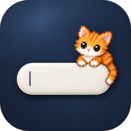

# hub-plugin-petdex

> Original author: [@ManyLattice](https://github.com/ManyLattice) · upstream: [ManyLattice/hub-plugin-petdex](https://github.com/ManyLattice/hub-plugin-petdex). This is the copy the Hub catalog installs; the author's updates are taken into it from upstream.
>
> License: MIT (ManyLattice)

A plugin for [Agents Hub](https://github.com/flagman/agents-hub-core): a pet from the open
[petdex.dev](https://petdex.dev) gallery sits on the input field of the open session and shows what it does - with the
same frames as Petdex pets in Codex and Claude Code:



| Session | Pet |
|---|---|
| working | runs |
| asking you, waiting for a permission | waves |
| finished a turn | jumps |
| waiting for its own background work | looks around, thinks |
| starting up | waits |
| failed | is sad |
| free | breathes |

Click the pet to make it jump. Thousands of pets to pick from - "Settings" → "Pet", with a search by name. There you
also pick where it sits: on the session's input field (you can drag it along the edge) or in the header of the session
list, where it shows the whole fleet: someone is waiting for you - it waves, someone failed - it is sad, sessions are
working - it runs.

## How it works

- `main.py` - a process next to the hub (`run`). It keeps a copy of the Petdex catalog
  (`<state folder>/petdex/manifest.json`, refreshed once a day) and searches it: the catalog itself is served without
  CORS, so the page cannot read it. It downloads the chosen pet's images and the thumbnails from `assets.petdex.dev`
  once. It talks to the hub page on `127.0.0.1:<page port + 9>` and only to it.
- The chosen pet is a post to the plugin's channel (API 1.2), so it is the same on every hub page, including on a phone
  (there the image comes straight from `assets.petdex.dev`).
- `web/main.js` - the page module: the pet on the input field (the `session.composer` place) or in the sidebar header
  (`sidebar.header`) and the "Pet" tab. The place and the position are a setting of this browser.

The Petdex code (CLI, app, agent hooks) is not installed or run. The plugin sends no telemetry or install counts to
Petdex, it only downloads the public catalog and images. Every pet has its own author, named in the tab with a link to
the pet's page.

## Tests

```
PYTHONPATH=<hub code folder>:. python3 -m unittest discover -s tests
```
